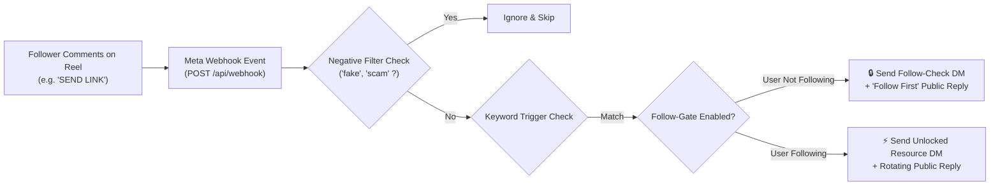

# 🚀 Instagram Comment Automator (Reels & Posts)

<div align="center">


### The Free, Open-Source Alternative to Hypello & ManyChat.
**Automate comments, enforce Follow-Gates, and dispatch instant DMs on Instagram Reels and Posts — 24/7, with zero monthly subscription fees.**

[](https://opensource.org/licenses/MIT)
[](https://nodejs.org/)
[](https://render.com/deploy?repo=https://github.com/udhawan007/instagram-automator)
[](http://makeapullrequest.com)
[](#)

<br/>

[](https://render.com/deploy?repo=https://github.com/udhawan007/instagram-automator)

</div>

---

## 🌟 Why This Exists

Commercial tools like **Hypello**, **ManyChat**, and **Buffer** charge steep monthly subscriptions ($20 – $100+/month) while placing artificial caps on the number of comments and DMs you can send.

**Instagram Comment Automator** gives creators, marketers, and businesses the same powerful Reels & Posts automation capabilities for **$0/month** by connecting directly to Meta’s official, free Graph API.

---

## ✨ Features

- 🎯 **Comment-to-DM Automation:** Automatically send direct messages with guide links, discount codes, or files whenever someone comments on your Reel or Post.
- 🔒 **Follow-Gate (Follow to Unlock):** Require commenters to follow your profile before unlocking their DM link. Non-followers receive a follow prompt with a quick-action unlock button.
- 🛡️ **Anti-Spam Rotating Public Replies:** Rotate between multiple comment reply variations (with `@username` tagging) so your account never triggers Instagram spam filters.
- ⚠️ **Negative Keyword Filters:** Exclude comments containing words like `scam`, `fake`, `bot`, or `refund` from triggering responses.
- 📱 **Interactive Reels Simulator:** Built-in iPhone sandbox to test keyword triggers, follow gates, and DMs without needing an Instagram account connected.
- ☁️ **24/7 Cloud Ready:** Deploy to [Render.com](https://render.com) in 60 seconds with zero configuration. Runs 24/7 even when your laptop is turned off.
- 📲 **Mobile-First & PWA UI:** Sleek mobile bottom navigation bar, touch-friendly sheets, and "Add to Home Screen" support so you can operate it on your iPhone or Android.
- ⚡ **Zero External Dependencies:** Built with pure Node.js and persistent native `node:sqlite` for sub-15ms execution and instant startup.

---

## 🎨 Built for Creators: Turn Views into Followers & Revenue

If you are a creator, influencer, coach, or brand posting Reels on Instagram, **comment automation is the #1 growth strategy in 2026**:

1. **🚀 Explode the Instagram Algorithm:** Instagram pushes Reels with high comment counts into the Explore page and suggested feeds. By asking viewers to comment a keyword, you multiply your comment volume by 10x–50x.
2. **📉 Zero "Link-in-Bio" Friction:** Viewers hate leaving Reels to click a bio link. Comment-to-DM delivers the resource directly into their private inbox while they continue watching your content.
3. **📈 2x–5x Follower Growth via Follow-Gate:** Non-followers who comment receive an interactive message asking them to follow first. Over 70% of viewers complete the follow step to claim their freebie.
4. **💰 Automated Sales & Lead Generation:** Deliver affiliate links, discount codes, email opt-in pages, or course checkouts on autopilot while you sleep.

---

## 🪝 Battle-Tested Creator Hooks & CTA Library

Drop these proven call-to-action hooks into your **Reel video text**, **captions**, and **audio** to drive thousands of automated comments:

| Niche / Goal | Reel Caption / Video On-Screen Hook | Recommended Trigger Keyword |
| :--- | :--- | :--- |
| **📘 Free Blueprint / Ebook** | *"Want the complete 5-step checklist? Comment **`GUIDE`** below and I'll DM it to you right now! 🚀 (Must be following to receive!)"* | `guide`, `link`, `blueprint` |
| **🏷️ E-Commerce / Flash Sale** | *"Drop a comment with **`VIP`** to get your exclusive 20% discount coupon sent straight to your inbox! 🛍️"* | `vip`, `discount`, `code` |
| **🎓 Webinar / Course Access** | *"Comment **`ACCESS`** to claim your free seat for this Thursday's live workshop before spots close! 🎟️"* | `access`, `invite`, `seat` |
| **📸 Influencer Presets / LUTs** | *"Want the exact camera settings & color LUT I used in this reel? Comment **`PRESET`** and I'll send it over! ✨"* | `preset`, `lut`, `filter` |
| **💼 Coaching / Consulting** | *"Comment **`AUDIT`** and my team will send you a personalized breakdown of your profile! 📈"* | `audit`, `review`, `strategy` |
| **📂 Templates / Spreadsheets** | *"I spent 40 hours building this automated tracker. Comment **`TEMPLATE`** to copy it for free! 📊"* | `template`, `sheet`, `copy` |

> 💡 **Built-In 1-Click Templates:** In your dashboard's automation builder, click any of the **Creator Hook Templates** to auto-fill all keywords, follow-gate prompts, and DM bodies instantly.

---

## ⚡ Supported Webhook Event Hooks

This tool integrates directly with Meta's real-time Webhook infrastructure:

* **`comments` Hook:** Fires whenever a follower comments on your Reels, Posts, Carousel, or Video uploads.
* **`messaging_postbacks` Hook:** Triggers when a user taps interactive DM quick-reply buttons (e.g. *"I'm following now ✅"*).
* **`mentions` Hook (Optional):** Ready to expand for story mentions and tag notifications.

---

## 📊 How It Works



---

## 🚀 Quick Start (Run Locally in 60 Seconds)

### Prerequisites
- [Node.js](https://nodejs.org/) `>= 22.0.0`

### 1. Clone & Run
```bash
git clone https://github.com/udhawan007/instagram-automator.git
cd instagram-automator

# Start the server (zero external npm installs needed!)
node server.js
```

### 2. Open Dashboard
Visit **`http://localhost:3750`** in your browser.

---

## ☁️ 24/7 Free Cloud Deployment (Render.com)

To run your automation continuously around the clock without keeping your computer on:

1. Click the **Deploy to Render** button below:
   
   [](https://render.com/deploy?repo=https://github.com/udhawan007/instagram-automator)

2. Sign in with your GitHub account.
3. Render will read the included `render.yaml` blueprint and deploy on the **Free Tier**.
4. You will receive a permanent HTTPS URL (e.g., `https://instagram-automator-xxxx.onrender.com`).

> **Tip:** To keep the free instance awake 24/7 without idle spin-down, add a free 5-minute health check at [cron-job.org](https://cron-job.org) pointing to `https://your-app.onrender.com/api/status`.

---

## 🔑 Connecting Your Instagram Account (Live Mode)

1. **Switch Instagram Account to Professional:**
   * In your Instagram app: `Settings` &rarr; `Account type and tools` &rarr; `Switch to Professional Account` (select **Creator** or **Business**).
   * Link it to any Facebook Page.
2. **Generate a Meta Graph API Token:**
   * Go to [developers.facebook.com](https://developers.facebook.com/) and create a free App.
   * In the [Graph API Explorer](https://developers.facebook.com/tools/explorer/), add permissions:
     * `instagram_manage_comments`
     * `instagram_manage_messages`
   * Generate your token and convert it to a **Permanent Token** via [Access Token Debugger](https://developers.facebook.com/tools/debug/accesstoken/).
3. **Configure Settings:**
   * In the app dashboard, go to the **Settings** tab.
   * Paste your **Page Access Token** and toggle **Live Mode**.
4. **Subscribe to Webhooks:**
   * In your Meta App &rarr; **Webhooks** &rarr; Select **Instagram**.
   * Callback URL: `https://your-app.onrender.com/api/webhook`
   * Verify Token: Copy your verify token from the **Settings** tab.
   * Click **Subscribe** next to the `comments` field.

---

## 📱 Mobile App Installation (PWA)

Operate your automations on the go directly from your phone:

* **iPhone (Safari):** Open your cloud URL &rarr; Tap the **Share** button &rarr; Tap **Add to Home Screen**.
* **Android (Chrome):** Open your cloud URL &rarr; Tap the three dots **(⋮)** &rarr; Tap **Add to Home Screen**.

---

## 🛠️ Tech Stack

* **Runtime:** Node.js (v22+)
* **Database:** Native SQLite via `node:sqlite` (zero compilation, zero native bindings)
* **Frontend:** Tailwind CSS, Lucide Icons, Plus Jakarta Sans
* **APIs:** Meta Instagram Graph API (v19.0+), Webhooks Hub Protocol

---

## 📄 License

This project is open-source and available under the [MIT License](LICENSE).

---

<div align="center">
Made with ❤️ by <a href="https://github.com/udhawan007">Udit Dhawan</a>. Stars and contributions are welcome!
</div>
